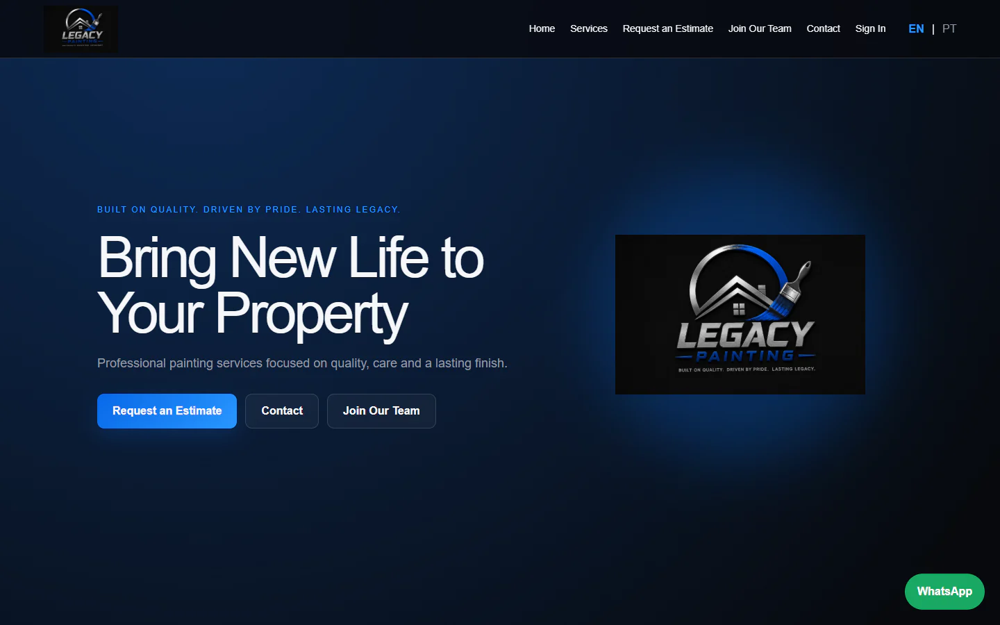
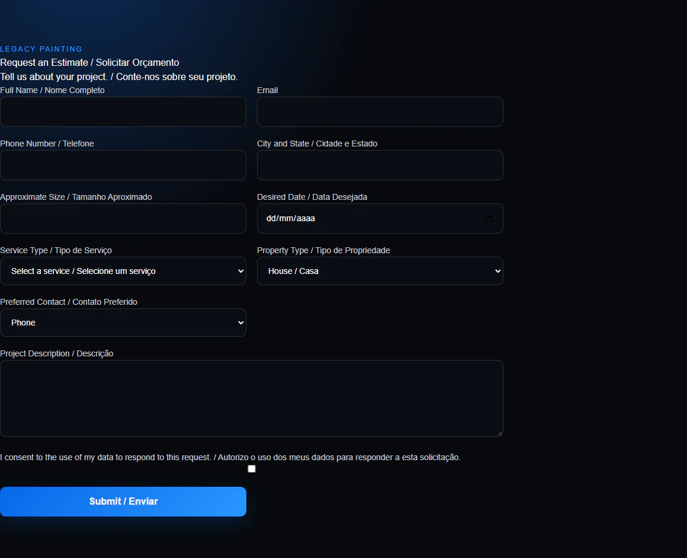

# Legacy Painting — Service Website & Dashboard

A painting-services business needs clear service information, structured estimate requests and a manageable follow-up process. This application connects a responsive service website to account access, administrative reporting and notification workflows.

**Documentation-only engineering case study. Source code remains proprietary.**

## What was developed

- Service presentation, navigation, estimate intake and recruiting forms.
- English/Portuguese selection with persisted preference; some forms/private screens remain only partially localized.
- Authentication, protected customer estimate history and role-checked administration.
- Server validation, SQL migrations and row-level-security policies.
- CSV export with formula safeguards, delivery status and protected email retry are implemented.

## Technology and technical decisions

Next.js 16.4.2, React 19.2.4, TypeScript, Tailwind CSS, React Hook Form, Zod 4.6.7, Supabase authentication/PostgreSQL, Nodemailer 10.1.4, Vitest and Testing Library.

Shared schemas align client and server validation. Server-side roles and database policies complement UI restrictions. Persistence and notification are distinct outcomes, allowing a saved inquiry to survive a delivery failure.

## Validation

Recorded local verification from **October 29, 2026** (earlier runs, reviewed for this package):

| Check | Result |
|---|---|
| Vitest | 32 tests in 8 files passed |
| Production webpack build | PASS |
| ESLint | PASS with 2 internal-navigation warnings |
| npm dependency audit | 0 reported vulnerabilities; historical 19-entry result is superseded |

Tests describe the exercised paths, not production usage or complete security coverage.

## Interface

Owner-approved historical local captures of the public homepage and empty estimate form. Client assets remain reserved for this presentation; no reuse license is granted.

## Development role

Portfolio owner and developer: **Studio Dev (@Studiodev00)**, as identified by the owner of this project. This case study presents implementation and verification evidence. It does not attribute every module exclusively to one person or establish employment, team size or business results from commit history.

## Current boundaries

Live Supabase accounts, database migrations and SMTP were not exercised. Existing guest submissions still return a service failure on any getUser authentication error; the missing-session path needs integration testing and remediation before a public demo. The historical narrow-screen validation overflow remains unverified. Localization, administrative UI depth and assistive-technology testing remain incomplete.

## Source and demonstration availability

This repository contains selected documentation and images only. It is not a buildable source distribution and grants no license to the private application. No binaries, production data or credentials are included. Screenshots appear in the Interface section; a supervised demonstration can be discussed with the project owner. No public application demo has been confirmed for this snapshot.

[Architecture](docs/ARCHITECTURE.md) · [Verified features](docs/FEATURES.md) · [Testing](docs/TESTING.md) · [Security](docs/SECURITY.md) · [Publication review](PUBLICATION_REVIEW.md)

No project source code may be uploaded to GitHub, publicly or privately. Only explicitly approved documentation and authorized images are eligible for publication.
